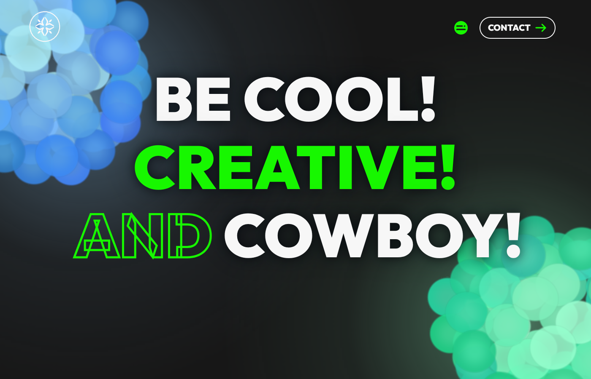

# Cowboy's WebSite

一个以「动画 + 3D」为核心的个人作品集网站，也是我的课程期末大作业。

网站使用 Vue 3 + TypeScript + Vite 构建，结合 GSAP / ScrollSmoother 做滚动叙事，Three.js 做实时 3D 场景。整体采用深色背景与荧光绿作为主视觉，页面之间通过绿色幕布完成转场。

**在线预览：<http://47.118.58.197/>**



<p align="center">
  
  
</p>

## 页面导航

| 路由     | 页面 | 内容                                                    |
| -------- | ---- | ------------------------------------------------------- |
| `/`      | 首页 | 果冻球体 WebGL 首屏、关于我、个人爱好横向滚动、结尾交互 |
| `/photo` | 图片 | 图片展示与鼠标跟随交互                                  |
| `/video` | 视频 | 视频作品展示                                            |
| `/music` | 音乐 | 10 张专辑的 3D CD 展示，支持滚轮、方向键、拖拽旋转      |
| `/skill` | 技能 | 绿色分屏 + 固定滚动，左半屏鼠标图标喷泉                 |
| `/email` | 联系 | 联系表单                                                |

## 技术栈

| 分类     | 技术                                                                   |
| -------- | ---------------------------------------------------------------------- |
| 框架     | Vue 3.5（Composition API / `<script setup>`）                          |
| 语言     | TypeScript 6                                                           |
| 构建     | Vite 8                                                                 |
| 状态管理 | Pinia 4                                                                |
| 路由     | Vue Router 5（History 模式）                                           |
| 样式     | Tailwind CSS 4、Sass、PostCSS                                          |
| 动效     | GSAP 3.15：ScrollSmoother、ScrollTrigger、MorphSVG、SplitText、DrawSVG |
| 3D       | Three.js 0.186：WebGLRenderer、Shader、PBR、PMREM、RoomEnvironment     |
| 物理     | Matter.js 0.20                                                         |
| 代码质量 | ESLint、Oxlint、Prettier、vue-tsc                                      |

## 功能亮点

### 开场与转场

- `index.html` 内置纯 HTML/CSS 的 `#boot-loader`，首屏渲染时立刻盖住页面，避免 JS 下载期间出现空白；
- Vue 挂载后由 `LoadingPage` 接管，SVG 图标做 MorphSVG 变形，随后幕布退出；
- 路由切换使用绿色 + 黑色双层幕布：绿幕盖住时回顶，黑幕完全盖住后才切换页面，避免看到旧页面内容。

### 首页

- 首屏使用 Three.js 着色器绘制果冻质感球体，并跟随鼠标产生视差；
- “About Me” 区域使用 Three.js TorusKnot + OrbitControls；
- 个人爱好区域使用 ScrollTrigger 固定 + 横向滚动；
- 结尾使用 Matter.js 做物理交互，并配合 GSAP 完成滚动叙事。

### 3D 音乐页

- 10 张专辑封面以 3D CD 形式排列，中间为当前专辑，两侧保留层叠唱片；
- 支持滚轮、方向键切换，支持拖拽旋转当前唱片；
- 正面为无光照的专辑封面；背面为金属/虹彩材质，叠加透明唱片纹理；
- 使用 PMREM + RoomEnvironment 提供环境反射。

### Skill 页

- 左侧绿色面板与右侧品牌图形分屏；
- 使用 ScrollTrigger 将内部容器 pin 住，滚动时右侧图形横向移动；
- 左半屏加入鼠标图标喷泉：根据指针移动距离生成图标，图标弹出、旋转后下坠；
- 图标来自 `src/assets/svg`，使用对象池循环复用，不重复创建 DOM。

### 滚动与页面高度

- 路由切换后重新计算 `ScrollSmoother` 的内容高度，避免新页面沿用旧页面长度；
- `ResizeObserver` 监听内容高度变化，处理图片/字体延迟加载；
- Skill 页的 pin 目标放在组件内部，并在 `onBeforeUnmount` 中 `revert()`，避免 `pin-spacer` 残留；
- 路由切换时在绿幕覆盖后回到顶部，新页面在 `scrollTop = 0` 的状态下挂载。

## 快速开始

### 环境要求

- Node.js `^22.18.0 || >=24.12.0`
- npm

### 安装依赖

```bash
npm ci
```

### 本地开发

```bash
npm run dev
```

### 生产构建

```bash
npm run build
```

构建前会先执行 `vue-tsc` 类型检查，产物输出到 `dist/`。

### 本地预览构建产物

```bash
npm run preview
```

### 代码检查与格式化

```bash
npm run lint
npm run format
```

## 构建与部署

这是一个纯静态 SPA，构建后的 `dist/` 可以直接交给 Nginx 托管。

```bash
npm run build
rsync -avz --delete dist/ user@your-server:/var/www/mine/
```

Nginx 需要为 History 模式配置回退：

```nginx
server {
    listen 80;
    server_name example.com;

    root /var/www/mine;
    index index.html;

    location = /index.html {
        add_header Cache-Control "no-cache";
    }

    location /assets/ {
        try_files $uri =404;
        add_header Cache-Control "public, max-age=31536000, immutable";
    }

    location / {
        try_files $uri $uri/ /index.html;
    }
}
```

修改后执行：

```bash
sudo nginx -t
sudo systemctl reload nginx
```

当前线上部署地址：**<http://47.118.58.197/>**。

## 项目结构

```text
src/
├── animation/                  # GSAP 动画封装、时长/缓动令牌
├── assets/                     # 字体、图片、SVG、唱片纹理
├── components/
│   ├── emailComponents/        # 联系表单
│   ├── homeComponents/         # 首页各区块
│   ├── musicComponents/        # 3D 音乐页
│   ├── photoComponents/        # 图片页
│   ├── skillComponents/        # 技能页
│   ├── videoComponents/        # 视频页
│   ├── LoadingPage.vue         # 开屏与路由幕布
│   ├── NavBar.vue
│   └── NavPanel.vue
├── icons/                      # 内联 SVG 图标组件
├── router/                     # 路由与转场守卫
├── stores/                     # Pinia 全局动画状态
├── style/                      # 全局样式与 CSS 变量
├── utils/                      # 动画、文本拆分等工具
├── views/                      # 页面级组件
├── App.vue
└── main.ts
docs/screenshots/               # README 截图
index.html                      # 首屏 boot loader
```

## 实现说明

### 首屏加载

页面首次访问时，浏览器需要先下载并执行 JS。为了让开屏不依赖 Vue bundle，`index.html` 中预先放置了 `#boot-loader`；Vue 的 `LoadingPage` 挂载并绘制完成后，`App.vue` 再把它移除。这样顺序是：

**HTML 开屏 → JS/Vue 加载 → Vue 开屏接管 → 资源就绪 → 幕布退场**

### 3D 唱片背面

唱片背面使用一层独立的透明 `MeshBasicMaterial`，把 `src/assets/texture/normal/record.png` 作为 `map` 叠加在金属背板上。这张图是黑线 + alpha 的纹路遮罩，并不是法线贴图；如果直接塞进 `normalMap`，alpha 会被忽略，看不到纹路。

### Skill 图标喷泉

图标使用 `absolute` 定位在左面板内部，而不是 `position: fixed`。因为站点外层有 ScrollSmoother 的 transform，fixed 元素放在被 transform 的祖先中会跟随内容滚动，效果会错位。

## 浏览器与运行环境

- 建议使用最新版 Chrome、Edge、Firefox 或 Safari；
- 3D 页面需要浏览器支持 WebGL；
- 首次加载需要执行 JS bundle；
- 页面已针对桌面端做主要适配，移动端会调整 3D 相机距离与部分布局；
- 部分动效已适配 `prefers-reduced-motion`。

## License

[MIT](LICENSE) © 2026 Cowboy

作者：[Cowboy](https://github.com/Cowboy-YJX/)
